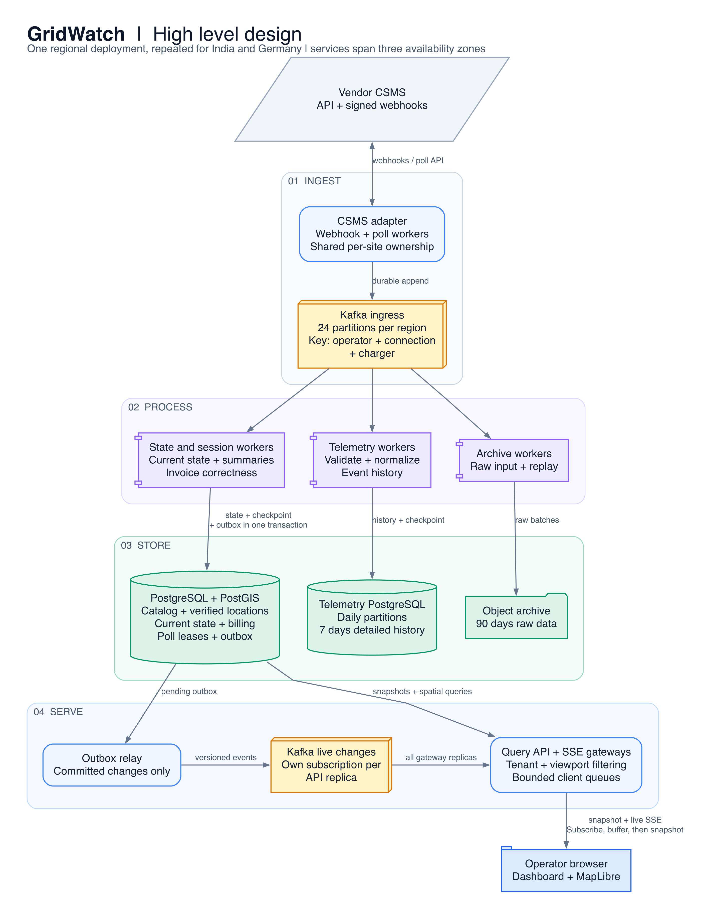

# GridWatch Architecture and Design

**Part A — Nirbhay**

## 1 My approach

I would build GridWatch for 50,000 chargers across 12,000 sites around a simple flow: receive vendor data, save it reliably, work out the latest charger state, and update the dashboard and map. The main challenge is keeping that view correct when the vendor sends late, repeated, or incomplete data.

There is one issue to resolve early: the vendor allows polling only every 30 seconds and can hold webhooks for 60 seconds. We cannot promise that a charger change will appear within five seconds with this feed. I would raise this before agreeing to the freshness commitment, while designing our own processing to be fast and measurable.

I would use Node.js/TypeScript, managed Kafka for reliable event storage, and PostgreSQL with PostGIS for business data and location queries. Keep one codebase, with ingestion, workers, and the API running separately so they can scale independently.

## 2 How data moves through the system

The HLD shows one regional deployment, repeated for India and Germany. Rounded boxes are services, raised boxes are Kafka topics, component shapes are worker pools, cylinders are databases, and the folder is object storage. [Editable diagram source](assets/gridwatch-hld.dot).

Ingestion verifies the webhook signature, identifies the operator from its vendor connection, and acknowledges the batch only after Kafka has saved it. Otherwise, the vendor can retry.

Workers validate events, convert timestamps to UTC, and save history and current state. They maintain site/region summaries as connector states change, so dashboard requests do not scan raw history. The API supplies snapshots and server-sent events (SSE) for live changes.

Use 24 ingress partitions per region, keyed by operator, vendor connection, and charger. This distributes chargers across six workers while keeping each charger's events together. Operational state, telemetry, and archiving use separate consumer groups, so each receives the full input and can recover independently. Partitions preserve arrival order; event-time checks still handle the vendor's out-of-order delivery.

Run this separately for India and Germany to limit outages and keep processing close to users. A combined view reads both deployments. Hosting and recovery locations need customer agreement; the brief does not establish legal residency requirements.

## 3 Handling the vendor feed correctly

The ingestion rules matter more than the framework choice:

- **Duplicates:** The stubs lack event IDs. Identify repeats using operator/vendor, charger, connector, type, timestamp, and business values—not delivery ID. Billing also enforces session-level uniqueness.
- **Late events:** Save history, but update status only with newer information. A delayed start must not reopen a completed session. Equal-time contradictions need reconciliation.
- **Bad records:** Save invalid events separately with a reason, and continue processing valid records in the batch. Missing energy is not zero.
- **429 and 500 responses:** Respect `Retry-After` for rate limits. Retry temporary failures with increasing delays and jitter, then alert on persistent failure.
- **Polling progress:** Advance the scan boundary only after all pages are safely accepted. Re-read an overlapping window to catch late data.

Confirm pagination limits and historical retention with the vendor. Until clarified, space same-site requests 30 seconds apart. Data outside the vendor's retained history may be unrecoverable.

All poll workers share one database lease per operator/vendor/site: a temporary owner, expiry, ownership version, and next allowed request time. Claim it atomically. Only the current owner can reserve the next request slot or advance the cursor. Reserve the slot centrally before sending; replacement workers respect it and reject updates from expired owners. This keeps multiple replicas from polling the same site too quickly.

Each database consumer saves its own checkpoint with its changes in that database transaction. Operational changes also create pending notifications in an outbox table. A relay publishes these to a Kafka live-change topic; retries are safe because updates carry entity versions. Each API replica uses a separate consumer group for live changes, so every replica receives every change. It filters by authorized tenant and viewport for its connected users.

The browser opens SSE and waits for the gateway's ready signal before requesting a snapshot. It buffers live changes, applies a consistent database snapshot, then applies only changes newer than each entity's snapshot version. Reconnecting or changing viewport repeats this handoff. Bound each client's queue to 1 MB or five seconds of pending changes; exceeding either limit closes the stream and forces a fresh snapshot instead of unlimited buffering.

Workers pause when a database is down; alert on queue age well before Kafka's 72-hour retention expires. An extended outage needs more retention or recovery from the archive.

## 4 What I would store

The core model follows the required hierarchy:

`Operator → Site → Charger → Connector`

| Entity | Key and important fields |
|---|---|
| Operators | `operator_id`; name, regional account, settlement timezone, currency |
| Sites | `(operator_id, site_id)`; address, country, nullable `geography(Point,4326)`, coordinate confidence |
| Chargers | `(operator_id, charger_id)`; site reference, vendor mapping, rated power |
| Connectors and current state | `(operator_id, charger_id, connector_id)`; status/time, latest Wh/W/time, observation time, quality flags, revision |
| Sessions | `(operator_id, vendor_id, session_id)`; connector reference, start/end times and registers, energy Wh, completeness |
| Tariffs and invoices | Versioned tariff with exact decimal price/fee; invoice unique by operator/vendor/session/revision, with amount, currency, and adjustment history |
| Settlement runs | Operator/regional account, local business date, revision; included invoices, totals, report reference |
| Telemetry | Event time, operator, charger, connector, fingerprint, register Wh, power W, raw reference; unique event time/operator/fingerprint |
| Site/region summaries and processing records | Status counts, active sessions, power; site leases/next request times, poll cursors, per-consumer checkpoints, versioned outbox updates, rejected events |

Every tenant-owned key and relationship includes the operator ID. Vendor IDs are also scoped to their connection, since two vendors could use the same identifier.

Separate production telemetry from operational PostgreSQL/PostGIS so historical writes and reports do not slow the map or billing. Both use the same database technology.

Detailed telemetry uses daily partitions and a composite index on operator/charger/connector/time. My starting retention policy is seven days online, 90 days of raw data in object storage, and 13 months of five-minute summaries. Financial retention needs separate agreement. Kafka keeps 72 hours for replay. Archive data before dropping old database partitions. These periods are assumptions to confirm.

## 5 The map and location queries

The vendor supplies addresses, not coordinates. Resolve them during onboarding through an approved geocoding provider, retaining source and confidence. Ambiguous matches need operator confirmation. Unresolved sites remain in the site list but stay out of spatial calculations.

Chargers share their site's coordinates. MapLibre shows clusters at wide zoom and site/connector details as users zoom in. Serve viewport-bounded vector tiles from PostGIS, caching geometry separately from live status. Refresh cluster counts as underlying status changes; do not regenerate all geometry for every event.

For **nearest available charger**, I would:

1. Find verified sites within a search radius using a PostGIS spatial index.
2. Keep chargers with at least one eligible, available connector whose observation is recent enough.
3. Sort by geographic distance and return the nearest results, including their observation times.

Use a GiST index with `ST_DWithin` to find nearby candidates, then `ST_Distance` to rank them in metres. Expand the radius if needed. Availability is an observation, not a reservation guarantee.

For **regions and density**, precompute site membership using indexed polygon queries such as `ST_Covers`. Count chargers, divide by geographic region area in km², count boundary sites once, and disclose excluded locations. Cache region/grid totals rather than repeating large spatial joins per request. Empty grid cells show coverage gaps; investment decisions also need demand and road-access data.

## 6 What freshness we can promise

| Requested target | Constraint |
|---|---|
| Status and faults: <5 s at P99.9 | Polling and delayed webhooks cannot guarantee this from source to screen |
| Session power/energy: <10 s at P99.9 | Readings are already about 10 s apart, and a continuous meter webhook feed is not promised |
| Dashboard tiles: <2 s at P99.9 | Needs clarification: source data age, update propagation, and page response time are different measurements |
| Map status: <10 s at P95 | Needs measured vendor delivery behavior before we can commit |

Target **under two seconds from receipt to screen for 99.9% of updates** at the agreed load, then test it. This internal target does not satisfy the source-to-screen contract. That needs faster vendor delivery or revised customer targets.

Show observation times and flag stale data. Silence alone does not mean offline: use current-state polls, recent readings, or documented heartbeats. A CSMS outage should raise an upstream incident, with affected chargers marked stale.

## 7 Energy and daily settlement

Meter values are lifetime Wh registers. Session energy is:

`(stop register − start register) / 1,000 = session kWh`

The German sample gives `41,420 Wh = 41.420 kWh`. Apply the per-kWh tariff plus session fee, using exact decimal arithmetic and currency rounding. Save the tariff version. Assume tariffs are selected at session start and priced directly in INR or EUR.

Hold negative register differences for review; they may indicate a reset. Prevent duplicate invoices with a unique operator/vendor/session/revision key.

Daily settlement groups eligible invoices by the operator's local business date. Use `Asia/Kolkata` and `Europe/Berlin`, including Germany's daylight-saving changes. Initially assign an invoice to the session's completion date and run settlement after a reconciliation allowance. Missing facts remain visible as exceptions; late corrections create a new report revision or adjustment. Never combine INR and EUR into one total without an agreed FX policy.

## 8 Availability and recovery

Each regional deployment spans three availability zones. Kafka has three replicas, `acks=all`, a minimum of two in-sync replicas, and unclean leader election disabled. PostgreSQL has a primary and two standbys, requiring durable synchronous acknowledgement from at least one. These choices protect acknowledged data during one node/zone failure. If safe writes are unavailable, processing waits.

| Failure | Recovery approach and initial objective |
|---|---|
| Application worker stops | Another worker resumes from its saved checkpoint; no acknowledged input lost; recover within 1 minute |
| Poll owner or API replica stops | Expired poll ownership can be claimed by another worker without resetting the rate-limit clock; browser reconnects to another API and repeats snapshot/live synchronization |
| Kafka broker or zone fails | Elect an in-sync leader; target RPO 0 for acknowledged records and recovery within 1 minute while sufficient replicas survive |
| Database primary fails | Fence the old writer and promote a standby containing acknowledged commits; target RPO 0 and RTO under 2 minutes for a single-node/zone failure |
| Database is temporarily unavailable | Kafka buffers input; dashboard shows increasing data age; replay after recovery |
| Entire region is lost | Warm recovery deployment in an approved second region; target RPO 5 minutes and RTO 30 minutes |

RPO is potential data loss; RTO is restoration time. Replicate Kafka, PostgreSQL, and archives asynchronously to the recovery region. The slowest replication gap limits recovery; the five-minute loss target can be exceeded during replication failure. Fence the old writer before promotion, replay from a safe checkpoint, and use business uniqueness to tolerate differences between the restored database and event log.

Keep continuous recovery logs and daily backups. Test restores monthly and rehearse failover under load. Reconcile settlement reports before resuming exports after regional recovery.

## 9 Rough capacity

The starting rate is `50,000 chargers / 10 seconds = 5,000 readings/second`. I would initially allow twice that ingress traffic for extra events and duplicates, then revise the estimate using actual connector counts and payloads.

| Item | Calculation across both deployments |
|---|---|
| Base volume | 5,000 × 86,400 = 432 million readings/day |
| Ingress planning allowance | 10,000 events/s × assumed 1 KB = 864 GB/day |
| Kafka storage | 864 GB × 3 days × 3 replicas = 7.78 TB, before overhead and spare capacity |
| Online telemetry at base volume | Assumed 200 bytes/indexed row × 432 million = 86.4 GB/day; about 605 GB for seven days, before replicas/backups |
| Raw archive | 864 GB × 90 days = 77.76 TB before compression and recovery copies |
| Site polling | 12,000 / 30 = 400 scan starts/s, before extra pages and retries |
| Live dashboard traffic | Assume 1,000 concurrent users × 20 relevant updates/s × 250 bytes = 5 MB/s payload, or 40 Mb/s, before protocol overhead and snapshot/tile requests |

Measure actual row sizes. If extra events are unique telemetry, online storage doubles. Add capacity for logs, replicas, backups, and Kafka overhead.

For an even country split, start each deployment with three managed Kafka brokers around 8 vCPU/32 GB and 4 TB each. Start database primaries at 16 vCPU/64 GB: 1 TB operational and 2 TB telemetry, with matching standbys. Start ingestion and API services at three replicas each, 2 vCPU/4 GB per replica.

At 5,000 planned events/s per region, six workers share 24 partitions: four each, averaging 833 events/s. Losing two workers leaves six partitions and about 1,250 events/s per remaining worker, assuming balanced traffic. Start each consumer pool this way at 2 vCPU/4 GB per worker; benchmark the failure-case rate and check partition skew. Database sizing includes both current-state updates and telemetry inserts. Recovery infrastructure is additional capacity.

The dashboard allowance is 2.5 MB/s per region under an even user split. Budget at least twice that for live transport headroom, and test initial snapshots and map tiles separately. The 1,000-user figure is an assumption to confirm; per-client queue limits and viewport subscriptions protect the service when clients are slow. Live-topic subscriber traffic grows with API replica count and belongs in the load test.

Validate these starting sizes under sustained load, bursts, and a zone failure. Queue growth affects freshness even without data loss. Send browsers relevant changes and summaries, not raw telemetry.

## 10 Security and operational visibility

Use OIDC login and verified operator membership, never a query parameter, for access. Enforce PostgreSQL row-level security for reads and writes through a non-owner role without bypass privileges, plus tenant-scoped foreign keys. Protect map tiles, live connections, and exports too. Include tenant and permission scope in cache keys.

Verify webhook HMAC signatures over the original request bytes. Use TLS, private database/broker access, managed secrets, encrypted backups, and per-tenant request limits. Audit tariff changes, billing adjustments, and manual coordinate corrections.

Measure source time, arrival, database commit, and browser render acknowledgement. Report source-to-screen and receipt-to-screen latency separately, counting eligible updates that never render as failures. Compare each contractual threshold and percentile over an agreed measurement window. Flag clock errors; use vendor reconciliation to detect undelivered events.

Use Prometheus/Grafana for queue age, stale connectors, vendor errors, rejected events, database latency, replication lag, and settlement exceptions. Alert on delay and missing data.

Before claiming the targets, replay the supplied failures and test production-rate input with the assumed dashboard load. Verify that competing poll workers respect one shared rate-limit clock, and that an update during snapshot loading reaches clients on every API replica. Kill a poll owner, overflow a slow client's queue, and repeat worker/database failures. Compare final state, invoice totals, latency, and recovery time. Pilot correctness alone does not establish production performance.

For product analytics, summarize charging time, energy, and faults by site and region. Calculate utilization as charging time divided by eligible connector time, showing unknown periods separately. Fault and threshold alerts need duplicate suppression and a cooldown; late events should correct affected summaries.

## 11 Main decisions and priorities

| Choice | Alternative considered | Reason and tradeoff |
|---|---|---|
| Kafka before processing | Write directly to the database | Buffer and replay during failures; adds a managed service |
| PostgreSQL/PostGIS with separate telemetry | One shared database, or a separate specialist analytics engine | Protect live queries while retaining one database technology; adds a cluster |
| Independent regional deployments | One global deployment or cross-country active-active writes | Limit outages and avoid competing billing writers; duplicate infrastructure and combine regional reads |
| Writes safe to repeat, with business uniqueness | Depend only on queue-level duplicate prevention | Vendor/poll duplicates still exist outside the queue; adds state/version checks but keeps replay safe |

I would first prove ingestion correctness and freshness measurements, then deliver the live map, settlement, and richer analytics. Charger control is outside our boundary; sharding is premature without a measured database limit; a custom identity system adds avoidable security work. Forecasting models are explicitly out of scope. Later, start with clean usage summaries and seasonal baselines, evaluating accuracy on future time periods.

Before production, my main questions are: Can the vendor guarantee faster delivery? How complete is its historical API? How should ambiguous addresses and meter resets be resolved? What are the agreed tariff, settlement, retention, and recovery rules?

The supplied JSON contains three sites and four chargers, despite referring to a larger pilot. It is useful for correctness checks; production sizing needs generated load and, ideally, the complete pilot dataset.

